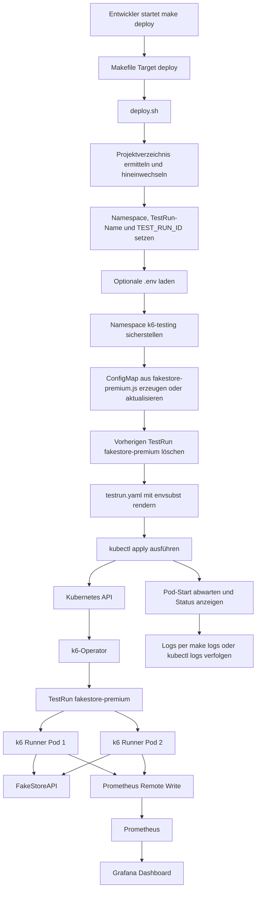

# FakeStore k6 Projektbeschreibung

## Ziel des Projekts

Dieses Projekt ist ein Beispiel fuer einen strukturierten k6 HTTP/API-Lasttest gegen die oeffentliche FakeStoreAPI.
Es zeigt, wie ein API-Test lokal ausgefuehrt oder ueber den k6-Operator in Kubernetes gestartet werden kann.

Der Test simuliert einen typischen Shop-Flow:

1. Produktliste laden
2. Kategorien laden
3. Produktdetails abrufen
4. Login durchfuehren
5. Warenkoerbe abrufen
6. Warenkorb anlegen

Die Messergebnisse werden als k6-Metriken erzeugt und im Kubernetes-Betrieb per Prometheus Remote Write an Prometheus uebertragen.
Grafana kann diese Daten anschliessend ueber ein Dashboard visualisieren.

## Projektaufbau

| Datei oder Ordner | Beschreibung |
| --- | --- |
| `fakestore-premium.js` | Zentrales k6-Testskript mit API-Flow, Lastprofil, Checks, Metriken und Summary |
| `Makefile` | Komfortable Kommandozentrale fuer haeufige Aufgaben wie Deployment, Logs, Status und Cleanup |
| `deploy.sh` | Deployment-Skript fuer den normalen Kubernetes-Testlauf |
| `demo-badrun.sh` | Startet einen absichtlich fehlerhaften Testlauf mit falschen Login-Daten |
| `k8s/fakestore-premium-testrun.yaml` | k6-Operator `TestRun` fuer den normalen Lasttest |
| `k8s/fakestore-badrun-testrun.yaml` | k6-Operator `TestRun` fuer den fehlerhaften Demo-Lauf |
| `k8s/fakestore-premium-configmap.yaml` | Referenz-ConfigMap; wird im normalen Workflow automatisch aus dem JS-Skript erzeugt |
| `Grafana/` | Enthaltenes Grafana-Dashboard fuer die Visualisierung der k6-Metriken |

## Architektur



Wichtig: Die `TEST_RUN_ID` beendet das Skript nicht. Sie wird frueh erzeugt und spaeter durch `envsubst` in das Kubernetes-Manifest eingesetzt. Danach laeuft `deploy.sh` weiter und fuehrt Namespace-Erstellung, ConfigMap-Erzeugung, Loeschen des alten TestRuns und das neue Deployment aus.

## Funktionsweise des k6-Testskripts

Die Datei `fakestore-premium.js` enthaelt die eigentliche Testlogik. Sie definiert:

- Ziel-URL der API ueber `BASE_URL`
- Login-Daten ueber `USERNAME` und `PASSWORD`
- Lastprofil ueber `TEST_VUS`
- Denkzeit zwischen Iterationen ueber `THINK_TIME`
- eindeutige Laufkennung ueber `TEST_RUN_ID`
- optionale Grafana-Annotationen ueber `GRAFANA_URL` und `GRAFANA_TOKEN`

Der Test verwendet ein rampendes Lastprofil:

| Phase | Dauer | Virtuelle Nutzer |
| --- | --- | --- |
| Ramp-up | 1 Minute | 0 bis `TEST_VUS` |
| Steady Load | 3 Minuten | konstant `TEST_VUS` |
| Ramp-down | 1 Minute | `TEST_VUS` bis 0 |

Jede virtuelle User-Iteration fuehrt den kompletten API-Shop-Flow aus.
Dabei werden k6-Checks ausgefuehrt, zum Beispiel ob ein HTTP-Status erfolgreich ist oder ob eine Antwort die erwarteten Daten enthaelt.

Zusätzlich werden Custom Metrics geschrieben:

- Dauer einzelner API-Schritte
- Gesamtdauer einer Journey
- Login Success Rate
- Checkout Success Rate
- API Error Rate
- erfolgreiche und fehlgeschlagene Journeys

Diese Metriken sind die Grundlage fuer Auswertung, Thresholds und Grafana-Dashboards.

## Deployment-Ablauf

Das Deployment erfolgt ueber `deploy.sh`. Das Skript ist der zentrale Ablauf fuer Kubernetes.

### 1. Strenge Shell-Optionen

```bash
set -euo pipefail
```

Das Skript bricht kontrolliert ab, wenn ein Befehl fehlschlaegt, eine Variable nicht gesetzt ist oder ein Fehler in einer Pipe auftritt.

### 2. Projektverzeichnis setzen

```bash
SCRIPT_DIR="$(cd "$(dirname "${BASH_SOURCE[0]}")" && pwd)"
cd "$SCRIPT_DIR"
```

Dadurch kann das Skript aus jedem beliebigen Verzeichnis gestartet werden und arbeitet trotzdem relativ zum Repository.

### 3. Basiswerte setzen

```bash
NAMESPACE="k6-testing"
TESTRUN_NAME="fakestore-premium"
export TEST_RUN_ID="fakestore-$(date +%Y%m%d-%H%M%S)"
```

Die `TEST_RUN_ID` ist eine eindeutige Kennung pro Testlauf.
Sie wird spaeter als Label beziehungsweise Tag in den Metriken genutzt und kann in Grafana als Filter verwendet werden.

### 4. Optionale `.env` laden

```bash
if [[ -f "${SCRIPT_DIR}/.env" ]]; then
  set -o allexport
  source "${SCRIPT_DIR}/.env"
  set +o allexport
fi
```

Falls eine `.env` vorhanden ist, werden die darin enthaltenen Variablen geladen und exportiert.
Das ist besonders nuetzlich fuer optionale Werte wie:

- `GRAFANA_URL`
- `GRAFANA_TOKEN`

### 5. Namespace sicherstellen

```bash
kubectl create namespace "${NAMESPACE}" --dry-run=client -o yaml | kubectl apply -f -
```

Dieser Befehl ist idempotent. Er erzeugt den Namespace, falls er fehlt, und aktualisiert ihn andernfalls ohne Fehler.

### 6. ConfigMap aus dem k6-Skript erzeugen

```bash
kubectl create configmap fakestore-premium-script \
  --from-file=fakestore-premium.js=fakestore-premium.js \
  --namespace="${NAMESPACE}" \
  --dry-run=client -o yaml | kubectl apply -f -
```

Das aktuelle `fakestore-premium.js` wird in eine Kubernetes-ConfigMap geschrieben.
Der k6-Operator kann das Skript dadurch spaeter aus Kubernetes heraus laden.

Der Vorteil: Man bearbeitet nur das JavaScript-Testskript. Die ConfigMap muss nicht manuell synchronisiert werden.

### 7. Alten TestRun loeschen

```bash
kubectl delete testrun "${TESTRUN_NAME}" -n "${NAMESPACE}" --ignore-not-found=true
```

Ein bestehender TestRun mit gleichem Namen wird geloescht.
Das verhindert Konflikte beim erneuten Starten.

### 8. Neuen TestRun starten

```bash
envsubst < k8s/fakestore-premium-testrun.yaml | kubectl apply -f -
```

`envsubst` ersetzt Platzhalter wie `${TEST_RUN_ID}`, `${GRAFANA_URL}` und `${GRAFANA_TOKEN}` im YAML.
Das gerenderte Manifest wird direkt an `kubectl apply` uebergeben.

### 9. Pod-Start abwarten und Hinweise ausgeben

Nach dem Deployment wartet das Skript kurz auf den Pod-Start, zeigt aktuelle Pods an und gibt den passenden Log-Befehl aus.

## Makefile

Das `Makefile` ist die einfache Bedienoberflaeche fuer das Projekt.
Es kapselt haeufige Befehle hinter kurzen `make`-Targets.

Optional wird eine `.env` eingebunden:

```make
-include .env
export
```

Wenn die Datei existiert, werden ihre Variablen geladen.
Wenn sie fehlt, laeuft `make` trotzdem weiter.

Die wichtigsten Variablen sind:

```make
NAMESPACE := k6-testing
TESTRUN   := fakestore-premium
BADRUN    := fakestore-badrun
```

Diese Variablen werden in mehreren Targets wiederverwendet.

## Wichtige Make-Targets

| Target | Zweck |
| --- | --- |
| `make help` | Zeigt alle dokumentierten Targets an |
| `make deploy` | Startet den normalen Kubernetes-Testlauf ueber `deploy.sh` |
| `make badrun` | Startet den fehlerhaften Demo-Lauf ueber `demo-badrun.sh` |
| `make logs` | Folgt den Logs des normalen Testlaufs |
| `make logs-badrun` | Folgt den Logs des Bad-Run |
| `make status` | Zeigt Pods und TestRuns im Namespace |
| `make clean` | Loescht aktive TestRuns, laesst Namespace und ConfigMap bestehen |
| `make clean-all` | Loescht den gesamten Namespace `k6-testing` |
| `make validate` | Validiert Kubernetes-Manifeste per Dry Run |

## Typischer Workflow

### Lokaler Testlauf

```bash
k6 run fakestore-premium.js
```

Optional mit angepasster Last:

```bash
RUN_MODE=local SUMMARY_MODE=detailed TEST_VUS=10 k6 run fakestore-premium.js
```

### Kubernetes-Testlauf

```bash
make deploy
```

oder direkt:

```bash
./deploy.sh
```

### Status pruefen

```bash
make status
```

### Logs verfolgen

```bash
make logs
```

### TestRuns aufraeumen

```bash
make clean
```

## Bad-Run Demo

Der Bad-Run ist ein absichtlich fehlerhafter Testlauf.
Er verwendet falsche Login-Daten und erzeugt dadurch sichtbare Fehler in Logs, Metriken und Dashboard.

Start:

```bash
make badrun
```

oder direkt:

```bash
./demo-badrun.sh
```

Der Bad-Run ist hilfreich, um zu zeigen, wie Fehlerbilder in Grafana aussehen:

- Login Success Rate faellt auf 0 %
- API Error Rate steigt
- Failed Journeys steigen

## Kubernetes-Komponenten

Im Cluster werden folgende Bestandteile verwendet:

- Namespace `k6-testing`
- ConfigMap `fakestore-premium-script`
- k6-Operator Custom Resource `TestRun`
- k6 Runner Pods
- Prometheus Remote Write
- Grafana Dashboard

Der normale `TestRun` verwendet:

```yaml
parallelism: 2
```

Das bedeutet, dass der k6-Operator zwei Runner-Pods startet.
Die Last wird auf diese Runner verteilt.

## Zusammenfassung

Das Projekt trennt die Verantwortlichkeiten klar:

- `fakestore-premium.js` beschreibt, was getestet wird.
- `k8s/*.yaml` beschreibt, wie der Test im Kubernetes-Cluster ausgefuehrt wird.
- `deploy.sh` fuehrt die konkreten Deployment-Schritte aus.
- `Makefile` stellt einfache Kommandos fuer den taeglichen Gebrauch bereit.
- Grafana und Prometheus dienen der Auswertung und Visualisierung.

Dadurch laesst sich das Projekt gut auf andere API-Testprojekte uebertragen:
Man ersetzt hauptsaechlich das k6-Skript, passt Kubernetes-Umgebungsvariablen an und kann den Makefile-Workflow weitgehend beibehalten.
