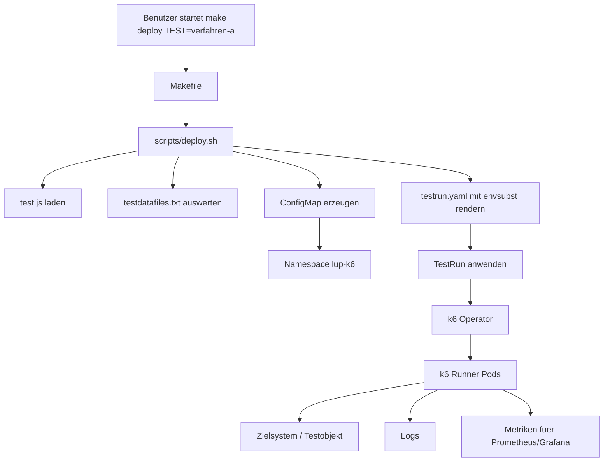

# k6 Tests

Dieses Repository enthaelt k6-Lasttests, die ueber den k6 Operator in Kubernetes ausgefuehrt werden.

Der k6 Operator wird zentral bereitgestellt. Dieses Repository verwaltet daher hauptsaechlich:

- k6-Testskripte
- k6 `TestRun`-Manifeste
- optionale Testdaten pro Test
- RBAC-Manifeste fuer den Namespace
- Hilfsskripte und Makefile-Befehle zur Ausfuehrung

## Zielstruktur

```text
k6-tests/
├── README.md
├── Makefile
├── rbac/
│   └── k6-operator-role.yaml
├── tests/
│   └── verfahren-a/
│       ├── README.md
│       ├── test.js
│       ├── testdatafiles.txt
│       └── testrun.yaml
└── scripts/
    └── deploy.sh
```

## Komponenten

| Pfad | Beschreibung |
| --- | --- |
| `Makefile` | Benutzerfreundliche Steuerung fuer Teststart, Logs, Status und Validierung |
| `scripts/deploy.sh` | Generisches Deploy-Skript fuer einzelne Tests |
| `rbac/k6-operator-role.yaml` | Kubernetes RBAC fuer den k6 Operator bzw. k6 Runner im Namespace |
| `tests/<testname>/README.md` | Beschreibung eines konkreten Tests |
| `tests/<testname>/test.js` | k6-Testskript |
| `tests/<testname>/testrun.yaml` | k6 Operator `TestRun`-Manifest |
| `tests/<testname>/testdatafiles.txt` | Optionale Liste zusaetzlicher Testdaten |

## Architektur



## Grundprinzip

Jeder Test liegt in einem eigenen Ordner unter `tests/`.

Beispiel:

```text
tests/verfahren-a/
├── README.md
├── test.js
├── testdatafiles.txt
└── testrun.yaml
```

Das `deploy.sh`-Skript erwartet genau diese Dateien:

- `test.js` ist Pflicht
- `testrun.yaml` ist Pflicht
- `testdatafiles.txt` ist optional
- `README.md` ist empfohlen

## Testdaten

`test.js` wird immer in die ConfigMap geladen.

Weitere Dateien werden nur geladen, wenn sie explizit in `testdatafiles.txt` stehen.

Beispiel:

```text
shared/data/betriebsformen.json
tests/verfahren-a/data/login-daten.json
```

Optional kann ein Zielname angegeben werden:

```text
betriebsformen.json=shared/data/betriebsformen.json
```

Dann kann die Datei im k6-Skript so verwendet werden:

```javascript
const betriebsformen = JSON.parse(open('./betriebsformen.json'));
```

Wenn ein Test keine Zusatzdaten benoetigt, kann `testdatafiles.txt` entfallen.

## RBAC

Die Datei `rbac/k6-operator-role.yaml` gehoert nicht zu einem einzelnen Test und wird nicht in die Test-ConfigMap geladen.

RBAC ist Kubernetes-Infrastruktur und sollte separat angewendet oder ueber GitOps synchronisiert werden.

Beispiel:

```bash
kubectl apply -f rbac/k6-operator-role.yaml -n lup-k6
```

RBAC muss in der Regel nur einmal pro Namespace eingerichtet werden.

## Zertifikate und Secrets

Zertifikate, RBAC und Secrets gehoeren nicht in `testdatafiles.txt`.

Grundregeln:

- `.crt` Dateien sind meist Trust-/Plattform-Konfiguration
- `.key` Dateien duerfen niemals unverschluesselt ins Repository
- private Zertifikate und Zugangsdaten gehoeren in Kubernetes Secrets
- RBAC gehoert unter `rbac/`
- Testdaten gehoeren in `testdatafiles.txt`, aber nur wenn das k6-Skript sie wirklich braucht

## Voraussetzungen

Auf dem lokalen System werden benoetigt:

- `make`
- `bash`
- `kubectl`
- `envsubst`
- Zugriff auf den Kubernetes Namespace `lup-k6`

Im Cluster werden benoetigt:

- zentral bereitgestellter k6 Operator
- Namespace `lup-k6`
- passende RBAC-Berechtigungen
- optional Prometheus/Grafana fuer Metriken

## Make-Befehle

Alle verfuegbaren Tests anzeigen:

```bash
make list
```

Details zu einem Test anzeigen:

```bash
make info TEST=verfahren-a
```

TestRun-Manifest validieren:

```bash
make validate TEST=verfahren-a
```

Test starten:

```bash
make deploy TEST=verfahren-a
```

Logs verfolgen:

```bash
make logs TEST=verfahren-a
```

Status aller TestRuns und Pods anzeigen:

```bash
make status
```

TestRun loeschen:

```bash
make clean TEST=verfahren-a
```

## Typischer Ablauf

1. Verfuegbare Tests anzeigen:

```bash
make list
```

2. Details zum Test anzeigen:

```bash
make info TEST=verfahren-a
```

3. Manifest pruefen:

```bash
make validate TEST=verfahren-a
```

4. Test starten:

```bash
make deploy TEST=verfahren-a
```

5. Logs verfolgen:

```bash
make logs TEST=verfahren-a
```

6. Status pruefen:

```bash
make status
```

## Was passiert bei `make deploy`?

Der Befehl:

```bash
make deploy TEST=verfahren-a
```

ruft intern auf:

```bash
scripts/deploy.sh verfahren-a
```

Das Deploy-Skript fuehrt folgende Schritte aus:

1. Testordner `tests/verfahren-a/` pruefen
2. `test.js` pruefen
3. `testrun.yaml` pruefen
4. optionale `testdatafiles.txt` auswerten
5. ConfigMap mit `test.js` und expliziten Testdaten erzeugen
6. bestehenden `TestRun` mit gleichem Namen loeschen
7. neuen `TestRun` anwenden
8. Pod-Start pruefen
9. Status, Pods, Logs und Diagnosebefehle ausgeben

## Beispiel `testrun.yaml`

```yaml
apiVersion: k6.io/v1alpha1
kind: TestRun
metadata:
  name: ${TESTRUN_NAME}
  namespace: ${NAMESPACE}
spec:
  parallelism: 2
  script:
    configMap:
      name: ${CONFIGMAP_NAME}
      file: test.js
  runner:
    image: grafana/k6:latest
    env:
      - name: TEST_RUN_ID
        value: "${TEST_RUN_ID}"
      - name: RUN_MODE
        value: "cluster"
      - name: K6_OUT
        value: "experimental-prometheus-rw"
```

## Ausgabe nach dem Start

Nach `make deploy TEST=verfahren-a` zeigt das Skript unter anderem:

- Namespace
- Testname
- TestRun-Name
- Test Run ID
- ConfigMap-Name
- verwendetes k6-Skript
- verwendetes `testrun.yaml`
- geladene Dateien in der ConfigMap
- aktuellen TestRun
- laufende Pods
- Log-Befehle
- Diagnosebefehle fuer Initializer-Probleme
- Grafana/Prometheus Filter

## Logs

Logs ueber Makefile:

```bash
make logs TEST=verfahren-a
```

Direkt mit `kubectl`:

```bash
kubectl logs -f -l k6_cr=verfahren-a -n lup-k6 --all-containers=true
```

Einzelne Pods anzeigen:

```bash
kubectl get pods -n lup-k6 -l k6_cr=verfahren-a
```

Einzelnen Pod loggen:

```bash
kubectl logs -f <pod-name> -n lup-k6
```

## Troubleshooting

TestRun anzeigen:

```bash
kubectl get testrun verfahren-a -n lup-k6 -o yaml
```

TestRun beschreiben:

```bash
kubectl describe testrun verfahren-a -n lup-k6
```

Pods anzeigen:

```bash
kubectl get pods -n lup-k6 -l k6_cr=verfahren-a
```

Pods beschreiben:

```bash
kubectl describe pod -n lup-k6 -l k6_cr=verfahren-a
```

Logs aller Container anzeigen:

```bash
kubectl logs -n lup-k6 -l k6_cr=verfahren-a --all-containers=true
```

ConfigMap pruefen:

```bash
kubectl get configmap verfahren-a-script -n lup-k6 -o yaml
```

## Haeufige Fehler

### Datei aus `open(...)` fehlt

Wenn das k6-Skript eine Datei laedt:

```javascript
open('./betriebsformen.json')
```

muss diese Datei in `testdatafiles.txt` stehen:

```text
shared/data/betriebsformen.json
```

oder:

```text
betriebsformen.json=shared/data/betriebsformen.json
```

### Falscher ConfigMap-Dateiname

Im `testrun.yaml` muss der Dateiname zur ConfigMap passen:

```yaml
script:
  configMap:
    name: ${CONFIGMAP_NAME}
    file: test.js
```

### RBAC fehlt

Wenn der k6 Operator keine Pods starten darf, muss die RBAC-Konfiguration fuer den Namespace geprueft werden:

```bash
kubectl apply -f rbac/k6-operator-role.yaml -n lup-k6
```

### Zertifikat falsch abgelegt

Zertifikate sollten nicht als Testdaten geladen werden, ausser das k6-Skript verwendet sie explizit.
Private Keys gehoeren nie unverschluesselt ins Repository.

## Namenskonventionen

Empfohlen:

```text
tests/<verfahren>/
tests/<verfahren>/test.js
tests/<verfahren>/testrun.yaml
tests/<verfahren>/testdatafiles.txt
```

Beispiele:

```text
tests/login-service/
tests/kundenportal/
tests/zahlungsservice/
tests/bestellstrecke/
```

## Zusammenfassung

Dieses Repository trennt bewusst zwischen Testlogik, Testdaten und Kubernetes-Infrastruktur:

- `tests/` enthaelt die fachlichen k6-Tests
- `rbac/` enthaelt Namespace-/Operator-Berechtigungen
- `scripts/deploy.sh` startet Tests generisch
- `Makefile` stellt eine einfache Bedienoberflaeche bereit
- `testdatafiles.txt` verhindert, dass unnoetige Dateien in jeden Test geladen werden

Dadurch koennen mehrere Verfahren im gleichen Repository gepflegt und kontrolliert im Namespace `lup-k6` ausgefuehrt werden.
